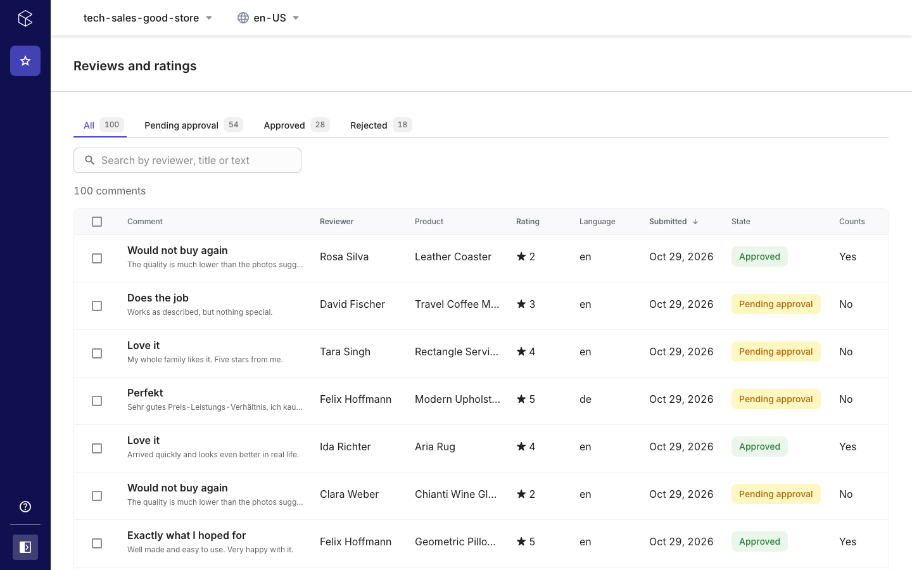
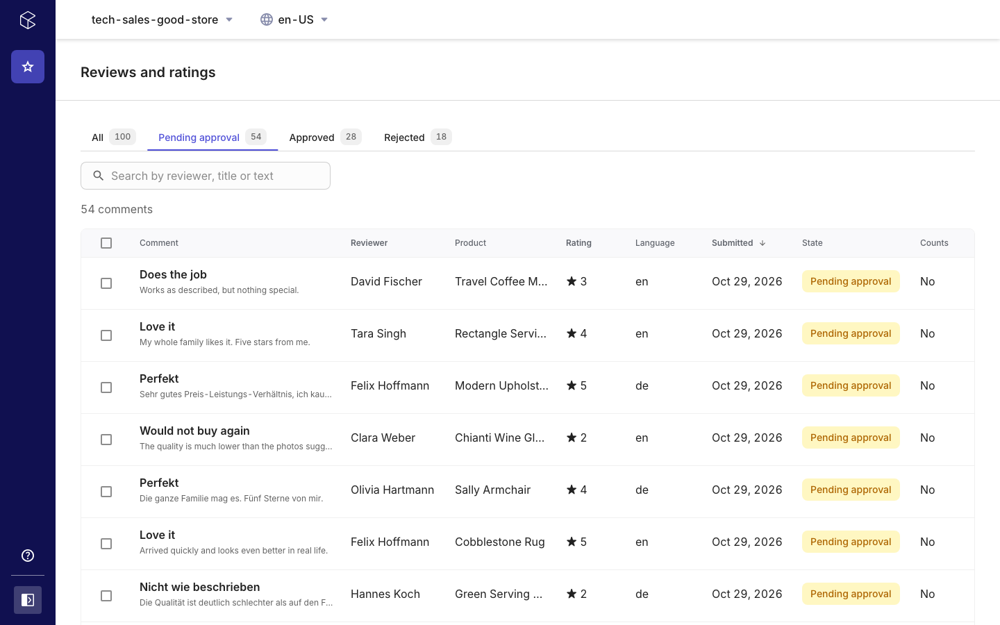
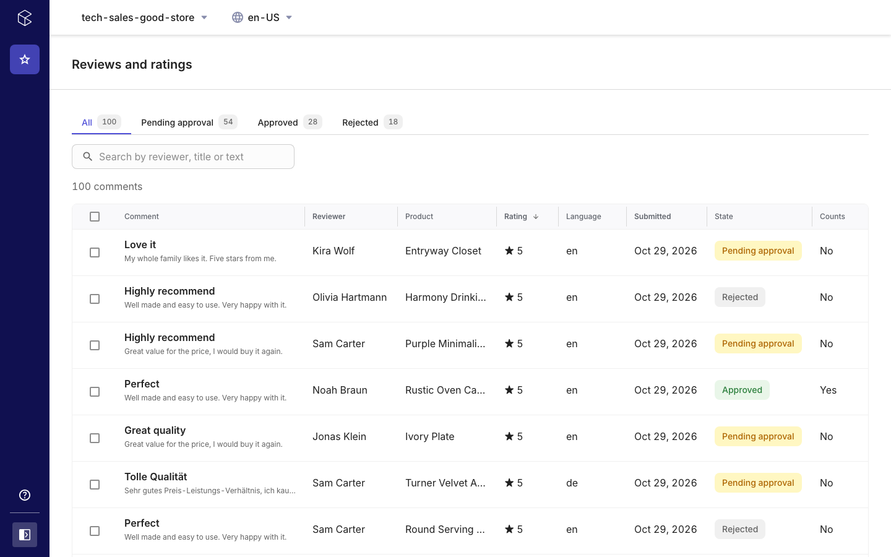
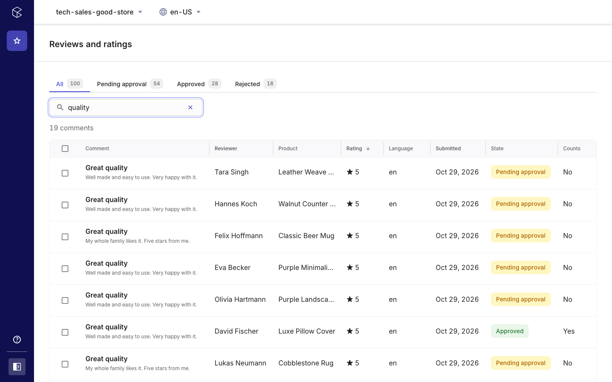
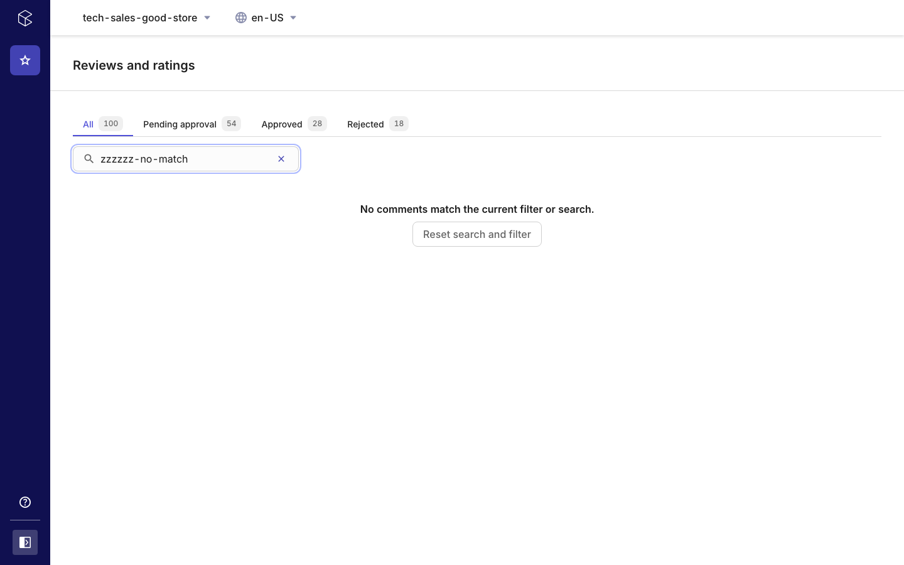
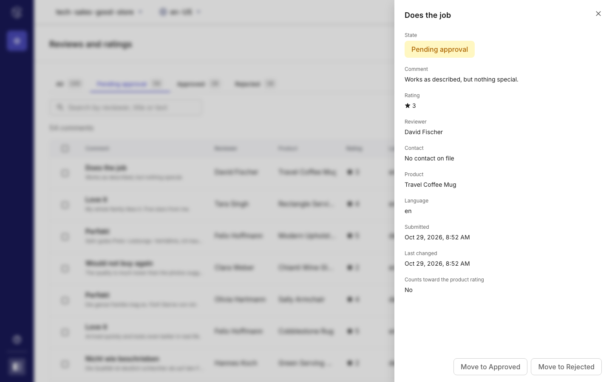
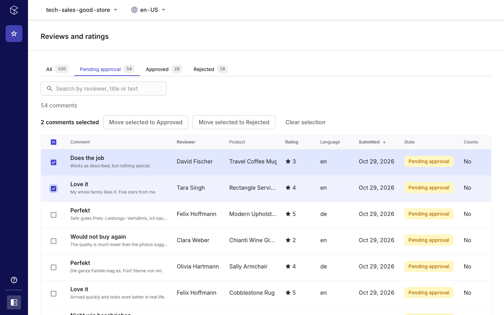

# Reviews and Ratings: features

Reviews and Ratings is a Merchant Center custom application for **moderating product review comments**: a queue of the project's reviews with state tabs and counts, search, sorting, a detail view and single or bulk decisions. Moderators work without a ticket and without a deployment.

How it is built, in short: a comment is a commercetools **Review**; its moderation state is a `ReviewState` State (Pending approval, Approved, Rejected). The app only reads reviews and runs the `transitionState` update action through the Merchant Center GraphQL proxy; it owns no data and no API client. Details: [`specs/001-comment-moderation/spec.md`](./specs/001-comment-moderation/spec.md), states and flow diagrams: [`docs/MODERATION-FLOW.md`](./docs/MODERATION-FLOW.md), setup: [`docs/SETUP.md`](./docs/SETUP.md).

## Comment queue

- One row per review: title and text preview, reviewer, product, star rating, language, submission date, state.
- State tabs (all, Pending approval, Approved, Rejected) with live counts.
- Server-side paging (20, 50, 100), state filter and sorting by date, rating and reviewer, reversible; page, filter and sort survive opening the detail.
- Search by reviewer, title and text over the 500 newest comments of the active filter, with a notice when more exist.
- Loading, empty, filtered-empty and error states.
- Rows degrade to a fallback label when product, reviewer or rating is missing.

## Comment detail

- Full text, rating, reviewer and contact, product, language, created and last changed time, whether the review counts toward the product rating.
- Opens as a side panel over the list.
- Only the actions in the review's own `state.transitions` are offered (Pending approval to Approved or Rejected; Approved and Rejected toggle).
- A stale `version` is reported as "this comment has already changed" and the current state is shown.

## Bulk moderation

- Select rows on the current page and move them to a state in one action (one button per non-initial state, by default Approved and Rejected; one transition per review). Reviews already in the target state are left as they are; changed, skipped and failed counts are reported.

## Permissions, language, configuration

- Manage permission is required for every transition; without it controls are disabled, never hidden. View is required to see the app at all.
- Every text exists in English and German.
- Hosting from one bundle on Connect (production) or Netlify (development, preview).

## Not included

- Creating, editing or deleting reviews; changing the state graph (the States are project data).
- An audit trail beyond the review's last-modified time.

## Known limits and open checks

- Review search covers the 500 newest comments of the active filter (query predicates match exactly, so partial text cannot be searched on the server); paging stops at the platform's 10,000-result offset limit.
- Not yet confirmed against a live project: that reading a review's state and transitions needs the `view_states` scope, and the response times for projects with thousands of reviews. The behavior is covered by specs that mock the GraphQL layer.

## Screenshots

The images in `docs/screenshots/` come from the seeded sample reviews (`scripts/seed-reviews.mjs`) in a commercetools sample project. They are regenerated with the Playwright scripts in [`mc-reviews-and-ratings-app/scripts/screenshots`](./mc-reviews-and-ratings-app/scripts/screenshots) (the signed-in user's picture is hidden). The scripts only navigate and select; they never change a comment.
