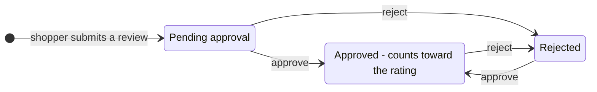
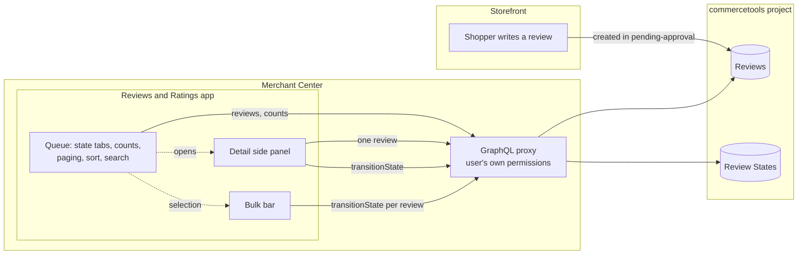
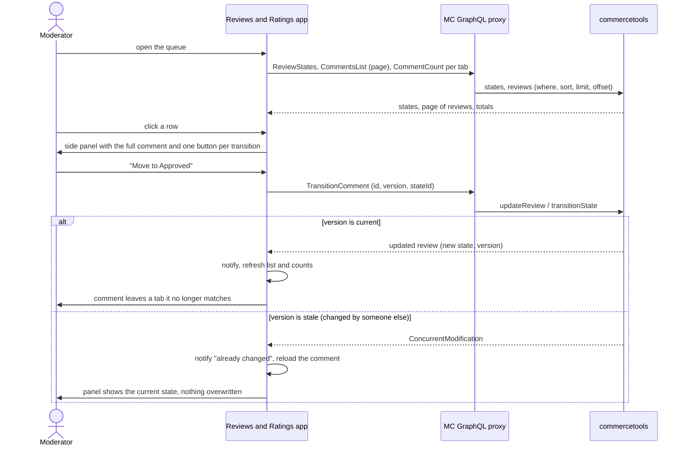
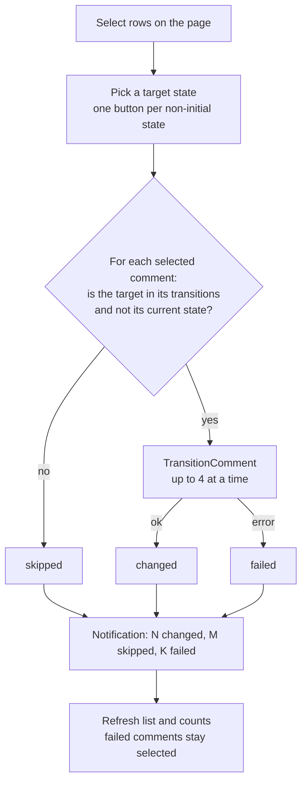
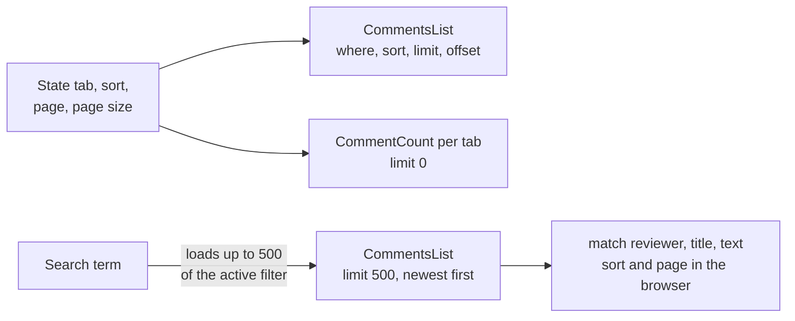

# Comment moderation: states and flow

How a comment travels from a shopper's submission to a decision, which states exist, and how the Reviews and Ratings app reads and changes them. The state model follows the commercetools [review approval process](https://docs.commercetools.com/guides/review-ratings#review-approval-process), extended by a `rejected` state. Setup of the states: [`SETUP.md`](./SETUP.md), behavior: [`../FEATURES.md`](../FEATURES.md), specification: [`../specs/001-comment-moderation/spec.md`](../specs/001-comment-moderation/spec.md).

## 1. The states

A comment is a commercetools **Review**. Its moderation state is a **State** of type `ReviewState`. They belong to the project, not to the app.

| Key | Shown as | Initial | Role | May move to | Counts toward the product rating |
|---|---|---|---|---|---|
| `pending-approval` | Pending approval | yes | none | Approved, Rejected | no |
| `approved` | Approved | no | `ReviewIncludedInStatistics` | Rejected | yes |
| `rejected` | Rejected | no | none | Approved | no |

A comment never goes back to *Pending approval* once it has left it. Whether a review counts toward its product's rating (`includedInStatistics`) follows from the role of the state it moves to.

The app does **not** hardcode this graph. Each comment offers exactly the transitions it reads from its own state (`state.transitions`), and the tabs are the project's `ReviewState` States. A project with other names or another graph works without a code change.

| The comment's state has ... | The app offers |
|---|---|
| transitions set, for example `[approved, rejected]` | exactly those |
| an empty list `[]` | nothing |
| no transitions set (the platform then allows any) | every other review state |
| no state at all | the initial state(s) |

## 2. The app at a glance

The app owns no data and no API client. Every read and write goes through the Merchant Center GraphQL proxy under the signed-in user's permissions.

## 3. What happens when someone moderates

### One comment

### Several comments

### Where the list data comes from

Query predicates match exactly, so partial-text search cannot run on the server. Paging, sorting, the state filter and the counts stay on the server; search looks at the 500 newest comments of the active filter and says so when more exist.

## 4. Permissions

| Permission | Effect |
|---|---|
| View (`view_products`, `view_customers`, `view_states`) | the app renders; the queue and detail are readable |
| Manage (`manage_products`) | transitions work, single and bulk |
| View without Manage | every transition control is shown **disabled**, never hidden, and the page shows a "View only" badge |

## 5. Screenshots

| | |
|---|---|
| The queue with the state tabs and counts |  |
| One state (Pending approval) |  |
| The detail side panel with the allowed transitions |  |
| Two comments selected, with the bulk bar |  |
| Search, and the no-match state with a way to reset |  |

They are regenerated with [`../mc-reviews-and-ratings-app/scripts/screenshots`](../mc-reviews-and-ratings-app/scripts/screenshots) and never change a comment.
